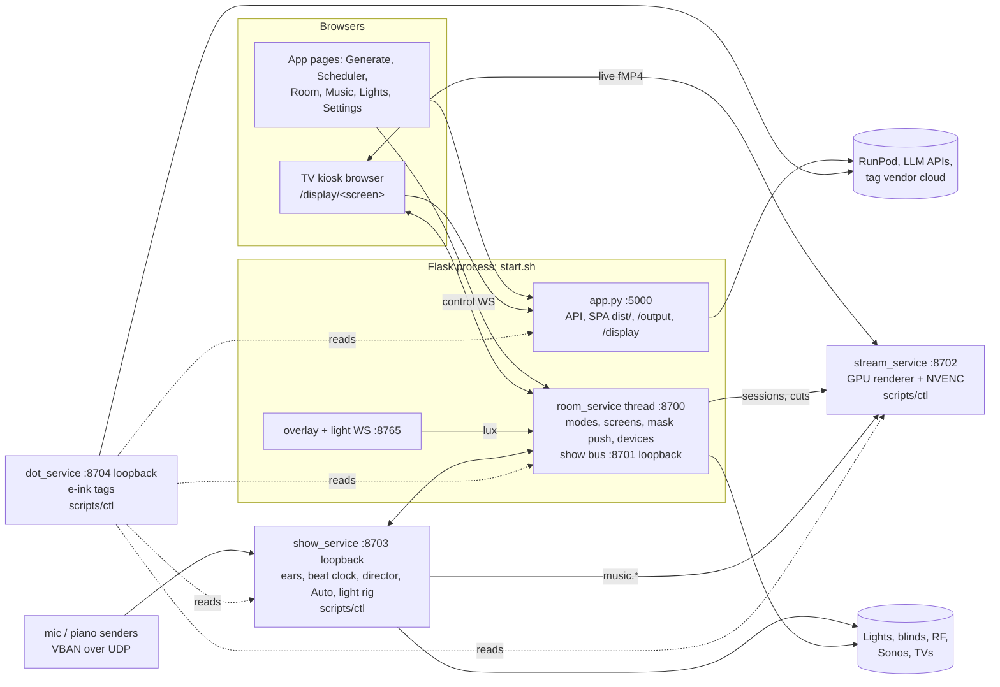

# Screen Machine

> **PC22, start here:** this branch (`deployments-generalisation`) moves PC22 onto the deployments layout. Before you
> change anything, read [docs/PICKUP_FROM_PC22.md](docs/PICKUP_FROM_PC22.md). It says what to commit first, how to
> merge and migrate, what to test, and the order for the history purge.

Screen Machine runs a room built around AI art. It generates pictures and short videos, puts them on wall
screens, and can switch those screens to a live, music-driven GPU render and back. It also drives the room's lights,
blinds and sound, and it listens to the room so it can follow whatever is playing.

- **Art:** images and videos are generated on RunPod (ComfyUI workflows) with LLM prompt refiners, then filed
  into per-screen *buckets* and published to screens by hand, by schedule, or by an art director that fills thin
  libraries. The art is tagged by AI so it can be searched and chosen.
- **Screens:** each TV is a browser in kiosk mode showing the app's `/display/<screen>` page. That page shows art,
  dimmed and warmed by a light-sensor mask. When the room asks, it cuts to a live 4K video stream and later cuts
  back to art.
- **Live:** a GPU renderer draws generative scenes (CUDA), encodes them with NVENC and streams fMP4 to the screens.
- **The room:** *modes* are whole-room configurations (screens art or live, lamps, glitterball, pinspots, blinds,
  Sonos). The room service runs the transition from one mode to the next.
- **Ears and Auto:** the show service takes the room's mic and the piano's MIDI, tracks beat, key and section,
  and publishes them on a show bus. Its art director sets looks for the lamps and screens. **Auto** switches the
  room's mode by itself to follow the music.
- **Tags:** small e-ink tags show the room's mode, Auto, what is playing, or today's art theme.

One codebase runs at several sites. Each site is a **deployment** (see below).

---

## Architecture

All the processes run on one Linux host. In production that is WSL2 on a Windows machine with an NVIDIA GPU.
The processes reach each other on loopback; the browsers on the LAN reach Flask, room_service and stream_service. The ports below are the defaults in `smconfig.DEFAULT_PORTS`, and a
deployment's manifest can change any of them.



| Process | Code | Started by | What it does |
|---|---|---|---|
| **Flask app** | `app.py`, `routes/`, `utils/` | `./start.sh start flask` (GNU screen `flask`) | The API, the built React app (`dist/`), `/output/` files and the display pages. Also runs the scheduler, generation jobs, the art director, art tagging, alerting, and the overlay/light WebSocket. |
| **room_service** | `room_service/`, started by `room_in_app.py` | a thread inside Flask (restart Flask to restart it) | The room control plane: modes and transitions, each screen's art and live state, the light-mask push to the display pages, the headless-Chrome snapshots used for the cut, and the device adapters (DMX/Art-Net in, Hue, RF, blinds, Sonos). Its own port serves the Room page's API and WebSockets, and passes `/renderer/*` and `/show/*` through to the services behind it. |
| **stream_service** | `stream_service/` | `scripts/ctl start stream` (screen `sm-stream`) | The live renderer. It runs on demand, so "stopped" is a normal state. One session per live screen, each pinned to a GPU. |
| **show_service** | `show_service/` (+ ML worker `show_service/ml/`) | `scripts/ctl start show` (screen `sm-show`) | Audio and piano MIDI in over VBAN (UDP). The senders stream to it when it asks (receiver-initiated), so it needs no inbound port forward. It runs DSP, beat and key tracking and an ML worker, publishes the show bus (`/v1/show`), and runs the director, Auto and the light outputs (Art-Net, Hue Entertainment). |
| **dot_service** | `dot_service/` | `scripts/ctl start dot` (screen `sm-dot`) | Draws each e-ink tag's card and sends it through the tag maker's cloud API. |

Other pieces outside the main processes:

- **Senders** (`tools/show_sender/`): a small agent next to each mic or the piano that streams audio and MIDI to
  show_service. One runs on the kiosk mini-PC, and a Windows agent covers WSL hosts.
- **Kiosk** (`media-server/`): scripts that set up and maintain the mini-PC that drives the TVs.
- **Shared libraries:** `smconfig/` (the deployment), `lightmask/` (lux to mask), `samsungtvws/` (a vendored TV
  control library), `piano_render/` (sampled piano playback), `utils/llm/` (LLM routing).

Contracts and design: `docs/av/contracts/LIVE_V1.md` (room ↔ renderer ↔ page), `docs/AV_PROGRAMME.md`,
`docs/SHOW_ENGINE.md`.

---

## Deployments

The code is the same everywhere. Everything that differs between sites lives in `deployments/<id>/`: the screens,
rooms, devices, lights, calibration, each service's flags, and the site's layer of `show.yaml`. A machine picks its
deployment with one line in `.env`:

```
SM_DEPLOYMENT=<id>
```

There is no default. A process that cannot tell which deployment it belongs to refuses to start, because a wrong
guess would drive another site's lights and screens.

- **Shipped deployments:** `example` is the smallest working site (one screen, nothing connected) and the template
  for a new one. `laptop` is a VJ rig without image generation. The production site has its own directory.
- **`deployment.yaml`** is the manifest: name, location, default room, ports, site wording, kiosk and host paths,
  and **capabilities**.
- **Capabilities** switch whole features on or off: `generation`, `art_director`, `art_tags`, `alexa`,
  `tv_power`, `kiosk_admin`, `alerts`, `ngrok`, `room`, `live`, `show`, `dot`, `dmx`, `hue`, `rf`, `blinds`,
  `sonos`. A capability the manifest leaves out is off. The list and what each one gates are in
  `smconfig.CAPABILITIES`.
- **`smconfig`** is how code reads the deployment. Code never names a site fact or builds a path to a deployment
  file by hand. It uses `smconfig.path("lights", "patch.yaml")`, `smconfig.url("room")` and
  `smconfig.enabled("generation")`.
- **Shared behaviour** is the same for every site: scenes, effects, vibes, show tuning, LLM routing, prompts and
  workflows. It lives in `config/`, `routes/data/` and `src/data/`.

```bash
python -m smconfig which          # the selected deployment
python -m smconfig check          # validate it (run after every edit to deployments/<id>/)
python -m smconfig dump           # everything every process resolves, as JSON
python -m smconfig get ports.room # one value
```

The full guide, including how to set up a new deployment, is in [`deployments/README.md`](deployments/README.md).

---

## Setting up a machine

**You need:** Linux or WSL2 (Ubuntu), Python 3.12, Node 22, GNU `screen`, `ffmpeg`, and `curl`. Live mode also
needs an NVIDIA GPU with CUDA 12 and NVENC.

### 1. Configuration and secrets

```bash
cp .env.example .env     # then fill it in
```

`.env` is per machine and git-ignored. `.env.example` lists the keys. The main ones:

| Key | Purpose |
|---|---|
| `SM_DEPLOYMENT` | which `deployments/<id>/` this machine runs |
| `SM_LAN_HOST` | this machine's LAN address. The deployment's `services/*.env` refer to it as `${SM_LAN_HOST}`, and room_service derives its allowed hosts from it. |
| `VITE_API_URL`, `VITE_WS_HOST`, `VITE_ROOM_URL`, `VITE_APP_LAN_URL`, `VITE_URL` | addresses the frontend build bakes in, and the app's own base URL |
| `OPENAI_API_KEY`, `GEMINI_API_KEY`, `RUNPOD_API_KEY`, `RUNPOD_ID`, `ASSEMBLY_AI_KEY` | generation, the LLMs (prompt refiners, art tags, show_service's listener) and transcription. `config/llm.yaml` names which key each LLM provider reads; a provider without its key is skipped. |
| `ADMIN_API_TOKEN` | the Flask admin API's bearer token |
| `ALERT_EMAIL_TO`, `GOOGLE_CLIENT_ID`, `GOOGLE_CLIENT_SECRET`, `GOOGLE_REFRESH_TOKEN`, `HEALTHCHECK_PING_URL` | alert e-mails and the health ping (only needed with `alerts`) |
| `ROOM_IN_APP=0` | optional: don't start room_service inside Flask |

Real addresses and keys go only in `.env`, never in `.env.example` or anywhere else in git.

**Secrets that are not env keys** live in `~/.config/screen-machine/` on each machine (directory mode 0700, files
0600). Code reaches them through `smconfig.secret(...)`. They include the TV pairing tokens (`samsung/`), Hue bridge
pairings (`hue/`), the blinds hub key (`rf/bloc_hub.json`), the light sensors' keys (`room_sensors.json`), the e-ink
tag API key (`dot.json`), room_service's token (created on its first start) and optional page keys
(`room_page_keys.json`). They never go in git. Pairings belong to the machine that made them: pair again on a new
machine.

`python -m smconfig.secrets check` lists what the deployment's switched-on capabilities need, set or missing, and
never prints a value. To give a second machine the shareable API keys, run `python -m smconfig.secrets export
<private file>` on one machine and `python -m smconfig.secrets import <private file>` on the other. The private file
lives outside the repo, for example in a private OneDrive folder. See deployments/README.md, "Secrets".

**Runtime state** lives in `~/.local/state/screen-machine/`: room and show state, the generation job history
(`jobs.db`), and logs and pidfiles for the `scripts/ctl` services. Art lives in `output/` and schedules in
`routes/scheduler/*.json`. All of these are git-ignored and per machine.

### 2. Python environments

Each service has its own venv, so a heavy dependency in one (CUDA, ML) can't break another.

| Venv | For | Install |
|---|---|---|
| `.venv` (repo root) | Flask + room_service | `python3.12 -m venv .venv && .venv/bin/pip install -r requirements.txt`, then `pyyaml` (smconfig needs it; `requirements.txt` does not list it) and room_service's extras: `playwright==1.58.0 pycryptodomex hue-entertainment`, plus `soco` where `sonos` is on (exact pins and the Chromium note are in `room_service/README.md`) |
| `~/.venvs/sm-stream` | stream_service | cupy-cuda12x[ctk], aiohttp, numpy, pyyaml, pillow, jsonschema, PyNvVideoCodec (see `stream_service/README.md`) |
| `~/.venvs/sm-show` | show_service | `pip install -r show_service/requirements.txt` |
| `~/.venvs/sm-show-ml` | show_service's ML worker (optional; Auto's full ears) | `pip install -r show_service/ml/requirements.txt`, then `python3 tools/show/fetch_models.py` (models go to `~/.cache/screen-machine/models/`, never git) |
| `~/.venvs/sm-dot` | dot_service | aiohttp, pillow, freetype-py, qrcode, pyyaml |

`smconfig` needs only the standard library and PyYAML, so every venv can import it.

### 3. Frontend

```bash
npm install
npx vite build --outDir dist_next --emptyOutDir && rm -rf dist_prev && mv dist dist_prev && mv dist_next dist
```

Flask serves `dist/` directly, so a rebuild goes live without a restart, and `dist_prev/` is the rollback. For
frontend work, `./start.sh start vite` runs the Vite dev server (port 8080) with hot reload. It proxies `/api` to
this machine's Flask.

### 4. Start

```bash
python -m smconfig check
./start.sh start flask        # Flask (+ room_service inside it); waits up to 30 s for /api/health
scripts/ctl start all         # stream, show and dot: only those whose capability is on
```

- `./start.sh {start|stop|restart|status} [flask|vite|ngrok|all]`. With no arguments it starts Vite, Flask and
  ngrok (ngrok only when the `ngrok` capability is on). Set `SCREEN_MACHINE_MODE=prod` to build `dist/` instead of
  running the dev server.
- `scripts/ctl {start|stop|restart|status} [stream|show|dot|all]` (default `all`), `scripts/ctl health <svc>`,
  `scripts/ctl logs <svc> [N]` and `scripts/ctl ports` (the ports the deployment uses). Each service's flags are in
  `deployments/<id>/services/sm-<svc>.env`. A `*_HOLD=` line in that file blocks start and restart until it is
  deleted (`--force` overrides; stop is never blocked).
- Then open `http://<lan-host>:5000/`. The Room console is at `/room`, and a TV loads `/display/<screen>`.

---

## Repository map

| Path | What |
|---|---|
| `app.py`, `config.py` | Flask entry point and constants |
| `routes/` | Flask blueprints and engines: generation and jobs, publishing, buckets, scheduler, display and overlays, light sensor, art tags, Alexa, admin, room bridge and hints |
| `routes/workflows/`, `routes/data/` | ComfyUI workflows; prompt, refiner and template data |
| `utils/` | logger, alerting (Siren), LLM routing, TV helpers |
| `overlay_ws_server.py` | the overlay and light-sensor WebSocket inside Flask |
| `room_in_app.py`, `room_service/` | the room control plane and its adapters (`adapters/`, `dmx/`, `hue/`, `roomstate/`) |
| `stream_service/` | the live GPU renderer, encoders and media server |
| `show_service/` | the room's ears, the director, Auto and the light rig; `ml/` is the ML worker |
| `dot_service/` | the e-ink tags |
| `lightmask/` | lux to mask (shared by Flask and room_service) |
| `smconfig/` | deployment loader and `python -m smconfig` CLI |
| `deployments/` | one directory per site (`README.md` explains them) |
| `config/` | shared behaviour: `live/` scenes, effects and transitions, `room/` show tuning, vibes and RF device types, `llm.yaml`, `art_tags.yaml`, `piano/`, `alexa/` |
| `src/` | the React + TypeScript app (Vite, Tailwind, shadcn/ui). Routes are in `src/App.tsx`, and the display page is `src/pages/DisplayPage` |
| `scripts/` | `ctl` (service control), `wsl-boot.sh`, migrations, `windows/` helpers |
| `tools/` | show senders, show and room calibration tools, the music library and score tools |
| `media-server/` | kiosk mini-PC setup and maintenance scripts |
| `piano_render/`, `samsungtvws/` | sampled piano playback; vendored Samsung TV library |
| `tests/`, `*/tests/` | test suites (below) |
| `docs/` | design notes, contracts, runbooks (below) |
| `experiments/` | read-only labs the services graduated from |

---

## Tests

`pytest.ini` anchors pytest at the repo root, and the root `conftest.py` selects the deployment the tests run
against (`SM_DEPLOYMENT`, default the production site's). Run each suite with the venv that runs that code:

```bash
.venv/bin/python -m pytest smconfig/tests tests lightmask/tests room_service/tests routes/art_tags/tests utils/llm/tests \
    --ignore=tests/integration -q      # tests/integration calls a running Flask
~/.venvs/sm-show/bin/python -m pytest show_service/tests -q
~/.venvs/sm-stream/bin/python -m pytest stream_service/tests -q    # GPU tests are opt-in (SM_GPU_TESTS)
bash tests/ops/test_ctl.sh                                         # scripts/ctl against a fake service
npm run lint && npm run typecheck:shared
```

`smconfig/tests` validates every shipped deployment. It also fails if code builds a path to a site file by hand.

---

## Operating

**Health**

- Flask: `GET /api/health` (`./start.sh status` only says whether each screen session is running)
- room_service: `GET :8700/healthz` and `/api/v1/status`
- stream, show and dot: `scripts/ctl status` (each probes the service's `/healthz`; exit code 0 means healthy, 3 stopped, 1 unhealthy)

**Logs**

| Process | Log |
|---|---|
| Flask console | `logs/flask_console.log` (the previous run's is `.1`) |
| room_service | `logs/room_service.log` |
| stream, show, dot | `~/.local/state/screen-machine/logs/<svc>_service.log`, or `scripts/ctl logs <svc>` |
| show_service detail | `~/.local/state/screen-machine/show/` (director, autopilot, listener, ML worker) |

**Restarts.** Restarting Flask also restarts room_service. Live sessions survive it, because the next start adopts
them. `./start.sh stop flask` waits up to 20 s for Flask to exit, so room_service can stop the Hue stream, the show
bus and the snapshot browser first. Restart the other services with `scripts/ctl restart <svc>`.

**On the production host.** Every long-running piece, including the Windows-side helpers, has a card in a separate
control dashboard (Spectre). A card calls only the piece's own scripts: `start.sh` or `scripts/ctl` for this repo's
services. Windows-side admin goes through that dashboard rather than by hand. `CLAUDE.md` has the working rules
for that machine.

**Rules of the house.** `CLAUDE.md` holds the working rules for anyone, human or agent, changing this repo: how
to deploy, the git rules, and what not to add.

---

## Further reading

Deeper docs. Some of them are working notes from the build, so check the date at the top of each one.

- [`deployments/README.md`](deployments/README.md): deployments, capabilities, a new site, room audio on WSL
- [`room_service/README.md`](room_service/README.md): running (alone and inside the app), auth, config, behaviour, API
- [`stream_service/README.md`](stream_service/README.md): running, API, profiles, plug-ins, performance
- [`show_service/README.md`](show_service/README.md): status, data flow, interfaces, deploy, and the build stages
- [`docs/SHOW_ENGINE.md`](docs/SHOW_ENGINE.md): the show engine design (ears, beat clock, director, Auto, lights)
- [`docs/AV_PROGRAMME.md`](docs/AV_PROGRAMME.md), [`docs/av/`](docs/av/): the room AV plan, contracts, the room state model
- [`docs/OPS_CONTROL.md`](docs/OPS_CONTROL.md): how the services are run and supervised
- [`docs/JOBS.md`](docs/JOBS.md), [`docs/ART_TAGS.md`](docs/ART_TAGS.md), [`docs/LIGHTS.md`](docs/LIGHTS.md),
  [`docs/display_modes.md`](docs/display_modes.md), [`docs/scheduler-events.md`](docs/scheduler-events.md)
- [`lightmask/README.md`](lightmask/README.md), [`media-server/README.md`](media-server/README.md),
  [`piano_render/README.md`](piano_render/README.md), [`tests/README.md`](tests/README.md)

**Known to be out of date.** Where these disagree with the code, `smconfig` and the code win.

- `tests/README.md` describes only the scheduler suites.
- `media-server/README.md` describes the kiosk as it was before room_service and the live path.
- `docs/archive/` is historical (the old refactor plan among it); `docs/REFACTOR_PLAN.md` is now the code-health
  list that replaced it.
- The service READMEs carry dated build notes: their run lines, token files and dev ports may lag the current
  setup. For how things are run today, trust `scripts/ctl`, `start.sh` and `CLAUDE.md`.

---

© Screen Machine. All rights reserved. Third-party code keeps its own licence (for example `samsungtvws/LICENSE`
and the shader licences in `stream_service/plugins/_lib/glsl/LICENSES/`).
