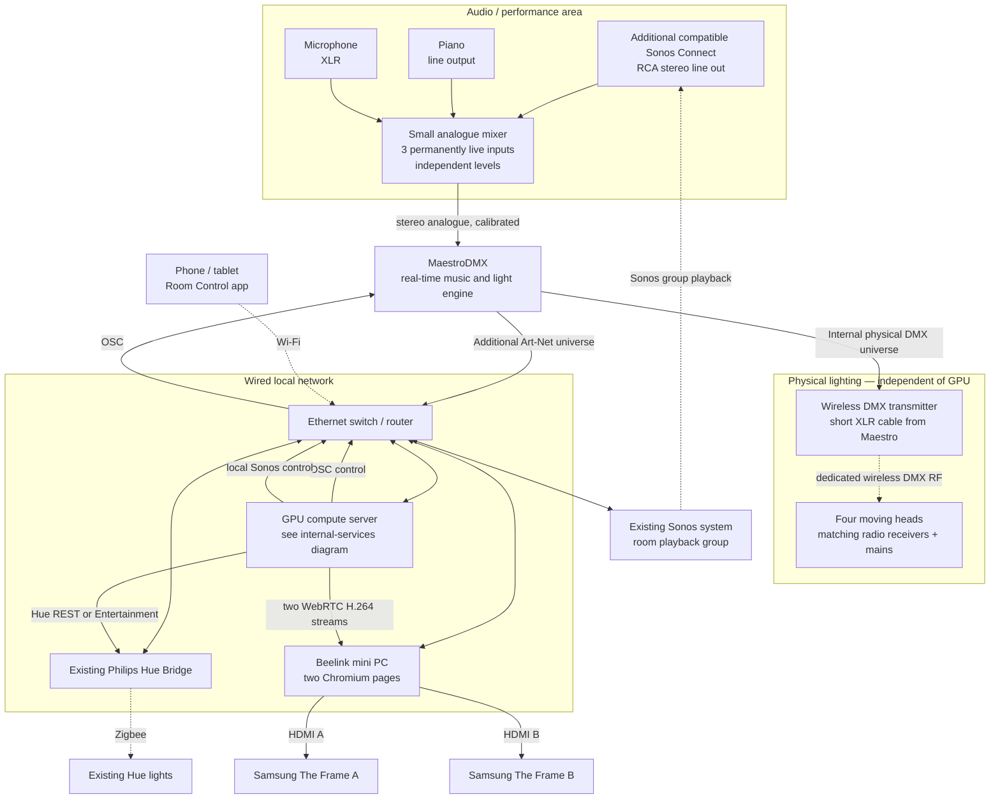
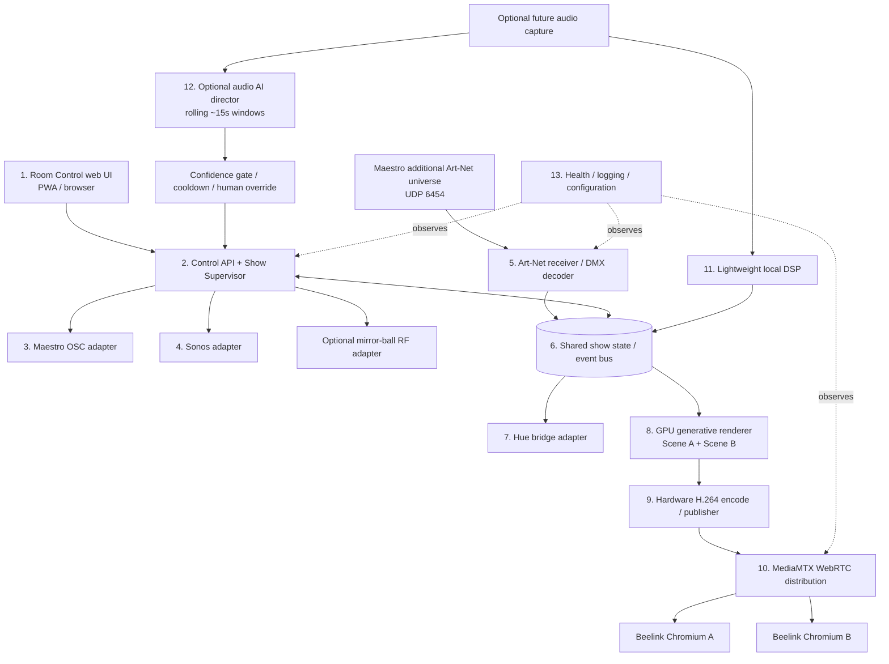

# Music-Responsive Room AV Installation

**System specification, architecture and delivery approach**  
**Version:** 0.1 — design baseline  
**Date:** 11 October 2026  
**Status:** Proposed architecture; procurement and critical integration tests outstanding

---

## 1. Executive summary

Create a largely autonomous, music-responsive audiovisual installation in a **10 m × 4 m room with a high ceiling**. Four floor-standing or low-plinth moving-head fixtures provide moving beams, gobos and theatrical accents. Existing **Philips Hue lighting** supplies ordinary ambient illumination and broad room washes. Two existing **Samsung The Frame 4K displays**, driven by two Chromium browser instances on a **Beelink mini PC**, show rich generative visuals rendered remotely on a more powerful GPU computer.

**MaestroDMX is the dedicated real-time lighting intelligence.** It listens to the combined Sonos, piano and microphone feed; selects music-reactive fixture parameters; and drives the physical moving heads over a **direct XLR DMX → wireless DMX transmitter** connection. Its additional **Art-Net universe over Ethernet** drives software-defined, DMX-addressable *virtual fixtures* representing the Hue lights and the two display compositions. A central GPU compute server translates these Art-Net values into Hue commands and rendered video, while also hosting a minimal local **Room Control** web app.

A compact analogue mixer near the piano combines **three always-live sources**: a co-located **Sonos Connect**, the piano line output and a microphone. It feeds Maestro directly without software, network audio transport or manual source selection. The Room Control app can pause/play the appropriate Sonos group and select Maestro shows; a pianist can therefore activate **Live Piano** with one tap.

A later optional enhancement captures digital audio at the GPU server and analyses overlapping ~15-second segments with an audio-capable model. This **AI Show Director** recommends or, if explicitly enabled, slowly adjusts lighting modes and artistic parameters. It must never replace Maestro's real-time control loop or compromise standalone lighting operation.

### Design priorities

1. **Just works:** basic music-reactive lighting must work without the GPU server.
2. **Minimal equipment in the room:** nominally four moving heads, with Hue fulfilling wash duties; no six-unit lighting array by default.
3. **One simple control interface:** phone/tablet browser, no manual input switching.
4. **Strong visual coherence:** screens behave like intelligent software lighting fixtures, not independent visualisers.
5. **Loose coupling:** documented protocols, adapters, restarts and graceful degradation.
6. **Selective ambition:** sophisticated generative visuals, but avoid rebuilding a moving-head choreography engine.

---

## 2. Scope and decisions

### Agreed baseline

| Area | Baseline decision |
|---|---|
| Room | Approx. 10 m × 4 m, high ceiling; four corner light positions |
| Lighting controller | **MaestroDMX**, dedicated autonomous controller, subject to acceptance testing |
| Physical lighting | Target **four** mains-powered pan/tilt moving heads; gobos required; final spot/wash mix TBD |
| Wireless lighting | **Maestro physical DMX XLR → short cable → one protocol-matched wireless DMX transmitter → receivers in/at lights** |
| Ambient illumination | Existing Hue lights; retain them as part of the show |
| Software lighting output | Maestro's **additional Art-Net DMX universe** to GPU server over wired LAN |
| Screens | Two non-adjacent Samsung The Frame televisions; independent compositions, no seamless panorama required |
| Display playback | Two locally hosted Chromium pages on existing Beelink; decode live streams, do not render complex graphics |
| Visual compute | Separate, capable CPU/GPU server; hardware video encoding |
| Video transport | **H.264 over WebRTC** on LAN as preferred prototype; not a stream of ordinary MP4 files |
| Audio sources | Sonos Connect stereo output + piano line output + microphone XLR; all continuously mixed |
| Audio mixer | Compact **Yamaha MG06-class** analogue mixer, with mic preamp and two stereo line inputs |
| User control | Minimal mobile-friendly, LAN-only web dashboard; manual mode selection and Sonos playback |
| Mirror ball | Optional 800 g ball beneath gasolier; spot aiming controlled by Maestro; motor automation is **unresolved** |
| AI music understanding | Optional future service, disabled by default, never in the real-time control path |

### Out of scope for the first release

- Building a new beat-tracking/moving-head-control engine.
- Mandatory automated genre detection or automatic Sonos source selection.
- Distributed Dante audio, audio-over-IP endpoints or Sonos-as-an-audio-capture protocol.
- Pixel-perfect synchronization across the two separate Samsung displays.
- Reliance on Maestro's undocumented internal REST or WebSocket APIs at runtime.
- A permanent hazer or chandelier-mounted motor before mechanical/safety approval.

---

## 3. Physical architecture



**Note:** Mermaid shows logical networking; the mixer, Maestro, transmitter, Hue Bridge and compute server need not share a cabinet. Prefer co-locating mixer, Maestro and transmitter in/near the piano room to minimise analogue cable lengths. Final placement is a site-survey decision.

### Network and cabling

| Link | Physical medium / protocol | Notes |
|---|---|---|
| Sonos Connect → mixer | Stereo RCA → suitable stereo line inputs | Configure fixed line-out level; check Connect generation compatibility |
| Piano → mixer | Piano line output → stereo/mono line inputs | Cable and level depend on piano model |
| Microphone → mixer | Balanced XLR | Gain trim, appropriate phantom power only if required |
| Mixer → Maestro | Short, level-matched stereo analogue connection | Verify Maestro input level; avoid overdriving consumer-level input |
| Maestro → wireless DMX transmitter | Short XLR DMX cable | Direct, wired physical output; **no Art-Net gateway** in this path |
| Wireless transmitter → heads | Compatible wireless DMX RF | Built-in fixture receivers preferred; mains power at each head remains necessary |
| Maestro → server | Ethernet / **Art-Net, UDP 6454** | Additional universe only; destination IP configured in Maestro |
| Server → Maestro | Ethernet / **OSC, UDP** | Default OSC port documented as 7672; verify actual configured value |
| Server → Hue Bridge | Ethernet / Hue local APIs | Bridge retains Zigbee link to existing bulbs |
| Server → Beelink | Ethernet / two live WebRTC feeds | Browser video decoding and fullscreen playback |
| Phone/tablet → server | Wi-Fi / HTTPS or HTTP on trusted LAN | No public internet exposure |

Assign DHCP reservations or static addresses to infrastructure devices. Prefer Gigabit Ethernet for server, Beelink, Hue Bridge and Maestro. Ensure Art-Net unicast destination configuration and any firewall rules are tested. **Art-Net is not audio and does not transport Maestro's microphone/line-input waveform.**

---

## 4. MaestroDMX roles and universe design

### 4.1 Verified manufacturer capabilities

The MaestroDMX v1.5 documentation describes **one internal physical DMX universe plus an additional Art-Net universe**. The Stage interface allows an Art-Net output to be added, nodes/IP destinations configured, and fixtures patched or moved between outputs. This strongly supports concurrent use of the two independently addressed universes, although commissioning should physically verify it using live fixtures. See [Maestro Art-Net guide](https://maestrodmx.freshdesk.com/support/solutions/articles/153000252041-art-net-and-maestrodmx) and [v1.5.1 notes](https://maestrodmx.freshdesk.com/support/solutions/articles/153000252248-download-maestrodmx-software-package-1-5-1).

**Important:** these are **separate universes**, **not mirrored copies**. The server will not automatically see the DMX values sent to the moving heads on Maestro's internal physical output.

Maestro also supports:

- Fixture profiles, including custom/importable **JSON** profiles.
- Stage backup/restore as JSON, including patch/layout/snapshots/FX information.
- Dynamic fixture attributes including `DIMMER`, RGB/HSV, `PAN`, `TILT`, `ZOOM`, `GOBO`, `PRISM` and **`ACTIVITY`**.
- Snapshots, FX palettes, shows and cues, including stationary movement positions for mirror-ball illumination.
- A documented **OSC input/control specification** for loading shows and controlling group parameters.

See [attributes](https://maestrodmx.freshdesk.com/support/solutions/articles/153000144498-understanding-attributes-in-maestrodmx), [fixture profiles](https://maestrodmx.freshdesk.com/support/solutions/articles/153000144499-fixture-profiles-overview), [stage backups](https://maestrodmx.freshdesk.com/support/solutions/articles/153000070486), [OSC](https://maestrodmx.freshdesk.com/support/solutions/articles/153000224681-open-sound-control-osc-specification) and [snapshot example](https://maestrodmx.freshdesk.com/support/solutions/articles/153000225568-fx-palette-examples).

### 4.2 Internal physical universe

Assign the four physical moving heads to unique non-overlapping DMX addresses on **Internal DMX**. Fixture mode determines their channel spans. Maestro's direct DMX XLR output drives one wireless transmitter, which broadcasts a single DMX universe to individually addressed compatible receivers.

If choosing the **Chauvet Sentinel Spot Q60 ILS** (12° spot, rotating gobos, built-in D-Fi) and/or **Sentinel Wash Q7Z ILS** (motorised zoom, built-in D-Fi), a **Chauvet D-Fi Hub 2** is a protocol-compatible transmitter candidate. D-Fi is **not universal**: replacing fixtures with W-DMX/CRMX-only models may require a different transmitter or external receivers. Confirm the final fixture mixture before purchasing radio equipment.

### 4.3 Additional Art-Net universe: software fixtures

Define custom Maestro fixture profiles representing **software-defined lighting devices**. “Virtual fixture” is *our architectural term*, not a first-party TV integration.

Proposed patch (illustrative, not a required channel layout):

| Art-Net DMX address | Fixture | Candidate attributes | Consumed by |
|---|---|---|---|
| 1–9 | `FrameA-Visual` | RGB, DIMMER, ACTIVITY, PAN, TILT, ZOOM, GOBO | Visual renderer A |
| 17–25 | `FrameB-Visual` | Same | Visual renderer B |
| 33–37 | `Hue-Ambience` | RGB, DIMMER, ACTIVITY | Hue adapter |
| Remaining | Reserved for future fixture groups | Explicitly allocated | Later use |

Only use **Maestro-recognised attribute types** for autonomous behaviour. Merely naming a channel “tempo” or “speed” doesn't expose BPM: Maestro documents `SPEED`, `ROTATION`, `STROBE` and `SHUTTER` as normally **static** attributes, while `ACTIVITY` is explicitly connected to Maestro's internal musical activity measurement. The precise activity response, independence of the two screen fixtures, colour/FX selections and Art-Net packet rate are **test items**, not guaranteed artistic outcomes.

**Art-Net contains up to 512 8-bit DMX channel values, not audio, BPM timestamps, beat phase, FFT data or a semantic “mood JSON” feed.**

### 4.4 Operating controls through OSC

Use the published OSC API for runtime control. Examples from Maestro's specification:

```text
/show/name                 string   # Load named saved show
/show/play                 no args  # Start the loaded show
/show/cue/index            int      # Select cue (1-based in documentation)
/live/1/excitement         float    # 0.0–1.0, fixture group 1
/live/1/motion/range       float    # 0.0–1.0
/live/1/energy             float    # 0.0–1.0
/live/1/palette/index      int      # Select palette by order
/global/brightness         float    # 0.0–1.0
/triggers/blackout         boolean  # Momentary blackout trigger
```

**Integration rules:** identify and persist the actual group indices and saved show names; verify OSC command semantics on installed firmware. Do not assume undocumented feedback, completion callbacks or status APIs. Maestro's internal REST/WebSocket facilities are **not a supported public integration contract**; avoid runtime dependence.

---

## 5. GPU compute server — logical services

The following blocks can be separate container processes, modules of one backend or native applications. Begin with a small number of processes; split services only for isolation/performance reasons. The GPU renderer may need a host-native process depending on the engine and OS.



### Service responsibilities

| Service | Responsibility | Candidate technology | First release? |
|---|---|---|---|
| `room-ui` | Mobile-first controls, mode presets, status, manual override | Static HTML/TypeScript PWA | **Yes** |
| `show-supervisor` | Orchestrate modes, enforce policy, expose API, manage state | FastAPI/Python or Node/TypeScript | **Yes** |
| `maestro-adapter` | Send documented OSC commands, configure address/port | OSC client library | **Yes** |
| `sonos-adapter` | Read group state; pause, play, volume; reconcile external app changes | Local UPnP/Sonos library or `node-sonos-http-api` | **Yes** |
| `artnet-receiver` | Receive designated universe, check freshness, decode fixture channels | Small UDP service | **Yes** |
| `show-state` | Normalised virtual fixture values and chosen operating mode | In-process pub/sub or lightweight event bus | **Yes** |
| `hue-adapter` | Map Art-Net parameters to brightness/palette with rate limits/fades | Hue local API; reuse `artnet-bridge` where appropriate | **Yes** |
| `visual-renderer` | Two separate, attractive GPU-generated compositions | TouchDesigner **or** custom GPU graphics engine | **Yes** |
| `video-publisher` | Transfer GPU frames to low-latency hardware H.264 encoding | GStreamer/FFmpeg/engine-specific output | **Yes** |
| `mediamtx` | Offer `/screen-a`, `/screen-b` live WebRTC browser streams | MediaMTX | **Yes** |
| `operations` | Structured logs, health endpoints, configuration/backups, restart | systemd/Docker Compose + metrics | **Yes** |
| `mirrorball-adapter` | Start/stop accessory motor using **verified** RF hub/driver | BroadLink-compatible protocol, **if proven** | Later/conditional |
| `audio-capture` / `audio-dsp` | Receive optional PCM, extract FFT, onsets, envelopes | USB device/network bridge + DSP | Later |
| `ai-show-director` | Interpret longer musical excerpts and recommend slow artistic changes | Audio-capable cloud or local model | Later, **off by default** |

**No need to run Home Assistant solely for Sonos/Hue/one RF control** unless it becomes valuable as a common device integration platform. Avoid coupling physical lighting to it.

### Internal state model

Use one canonical schema separate from the source-specific DMX channel order, for example:

```json
{
  "mode": "live_piano",
  "modeSource": "manual",
  "maestro": {"online": true, "artnetAgeMs": 30},
  "screenA": {
    "rgb": [0.25, 0.45, 0.90],
    "dimmer": 0.65,
    "activity": 0.42,
    "motion": [0.20, -0.10],
    "zoom": 0.55,
    "effectIndex": 2
  },
  "screenB": {"rgb": [0.75, 0.30, 0.55], "dimmer": 0.50},
  "hue": {"rgb": [0.25, 0.40, 0.80], "dimmer": 0.35},
  "sonos": {"group": "Music Room", "playback": "paused"}
}
```

This is **our schema**, not an actual Maestro response. The receiver needs configurable channel layouts and smoothing; startup defaults must be safe. Do not publish guessed statuses as actual connected-device telemetry.

### Minimal control API (proposed, not existing)

```http
GET  /api/status
POST /api/mode                 {"mode":"ambient|piano|disco"}
POST /api/show/intro
POST /api/sonos/play
POST /api/sonos/pause
POST /api/sonos/volume         {"value":35}
POST /api/lighting/brightness {"value":0.70}
POST /api/ai/enabled          {"enabled":false}   # only when AI added
```

Implementation should return explicit command outcomes and expose **observed state** separately from **desired state**. For Sonos, subscribe to actual status rather than trusting the last button press. For Maestro, note limitations of unconfirmed bidirectional status feedback.

---

## 6. Everyday user experience and modes

The normal UI should fit on one phone/tablet screen. Core controls: **Live Piano**, **Ambient**, **Disco**, **Show Intro**; Sonos **Play/Pause**, volume, global lighting level; optional **Blackout** and system status. Advanced fixture/calibration pages must be hidden from normal operation.

| Mode | Sonos | Maestro moving heads | Hue | Samsung Frames | Mirror ball |
|---|---|---|---|---|---|
| **Ambient** | User-controlled, optionally low volume | Gentle movement, discreet gobos/accents | Principal room illumination, warm/soft fades | Slow generative visuals | No intentional illumination; ideally stopped |
| **Live Piano** | **Pause** target playback group when mode selected | Slow, restrained, responsive to live piano/mic | Warm comfortable illumination with low activity | Reflective/expressive visuals | Not illuminated; ideally stopped |
| **Disco** | User chooses/resumes music | Active beams, rotating gobos, programmed ball-aim snapshots where desired | Rhythmic wash and palette accents | More kinetic graphics | Spotlight aimed at ball; motor starts **only if reliable integration installed** |
| **Show Intro** | Optional track action | Pre-built finite cue sequence and transition | Dramatic coordinated cueing | Intro visuals | Explicit cue-controlled, otherwise off |

**Mode is a user-selected show preset**, not an input selector. The mixer keeps Sonos, piano and microphone live at all times. In the common case, the pianist taps Live Piano, the app pauses Sonos, and playing the keys immediately produces an audio signal for Maestro. Manually playing/pausing Sonos from other apps should continue to work.

**Automatic genre recognition is not a requirement.** Any future AI-led mode switch must be optional and independently enabled. Start-of-show completion/return to live autonomy should be tested and implemented with reliable cues/timers rather than assumed callbacks.

### Mirror-ball aiming in Maestro

Set a snapshot for at least one selected moving head with fixed pan/tilt (zero movement width; offsets aimed at the ball), open gobo, and suitable beam/colour. Maestro's manufacturer shows this exact fixed-target technique for a wedding-cake spotlight; support has described the same technique for disco balls. Associate it with the Disco cue/FX palette. Verify movement limits, aiming repeatability and no beam crossing seated eye lines.

---

## 7. Audio subsystem — simple and standalone

### Required design

**Co-locate** an additional Sonos Connect, piano output, microphone and **small analogue mixer** near Maestro. Do **not** build a Dante network or a source-switching application for the baseline.

```text
Sonos Connect stereo RCA ────────┐
Piano line output (L/R or mono) ──┼──> Yamaha MG06-class mixer
Microphone (XLR) ────────────────┘       | independent input trims
                                         | all inputs permanently enabled
                                         v
                                  analogue stereo mix
                                         |
                                         v
                                MaestroDMX line input
```

A Yamaha **MG06** has two mono mic/line inputs and two stereo line-input pairs and can perform exactly this summing role. Select a microphone only after considering intended capture (singing into mic vs capturing room/piano acoustics); start with a suitable XLR microphone and stand. Set phantom power appropriately. Avoid feedback if the mic is amplified into the PA, and avoid inadvertently adding room pickup to an already clean Sonos feed.

Use a **Sonos Connect compatible with the currently running Sonos app/system**: Sonos lists **Connect Gen 2** as compatible with current Sonos and S1 systems, while **Connect Gen 1** is S1-only. Set the monitor Connect's line out to **Fixed**; mixer input trim calibrates music level, while the Sonos playback-group volume remains controllable independently. Group it with the room's actual audible playback source and test sync/delay.

Calibrate Maestro's analogue input using its input-level display and the manufacturer's guidance; don't assume a professional mixer's nominal output can be plugged into consumer RCA inputs at full gain. Minimise gain changes that flatten the dynamics Maestro is meant to respond to.

### Optional later digital audio

Art-Net **does not** pass through audio. To get PCM into the GPU server, add an **explicitly separate audio-capture path** from the mixer's output (or dedicated USB interface/mixer, if changed later). Because GPU and mixer are in different rooms, this requires a deliberately selected network-audio endpoint or future cable path. **It is not part of the baseline.** Keep the analogue mixer → Maestro connection independent of that enhancement.

Future digital audio enables FFT, envelopes, attacks and AI music description. Basic Maestro Art-Net `ACTIVITY` data should be enough to prototype visually reactive scenes without any of this additional plumbing.

---

## 8. Hue subsystem

Hue is the **room-wide ambient/wash layer**. Existing bulbs and Hue Bridge remain installed and continue to operate normally outside a show. The server's Hue adapter receives a dedicated Art-Net virtual fixture (RGB + dimmer + ACTIVITY if useful) and maps it to bulb/room colours and intensity.

Two supported conceptual modes:

1. **Standard local Hue API:** slow changes, scene recalls and ambient fades; simplest for Piano/Ambient.
2. **Hue Entertainment streaming:** more frequent music-responsive colour control where the bulbs and bridge support an Entertainment area; requires area setup and appropriate API pairing.

Evaluate open-source [Apollon77/artnet-bridge](https://github.com/Apollon77/artnet-bridge) rather than writing the entire Hue protocol stack. That project documents both ordinary Hue API and Entertainment streaming; its fitness for the actual Hue bridge, bulbs and firmware still requires testing. Account for rate limits, colour gamut, startup/stop behaviour, and cases where an active Entertainment stream owns the configured lights.

The Hue adapter must smooth commands rather than forward every DMX byte change as an individual Hue REST request. On Art-Net loss, adopt a defined fallback (e.g. a gentle safe ambient look), and restore normal Hue control cleanly when the show stops.

---

## 9. Generative video and display distribution

### Rendering ownership

The Beelink mini PC runs **two Chromium browser pages** connected to the GPU server. The two Samsung Frames are **not adjacent**; frame-perfect cross-screen choreography is not required. The pages have minimal logic and rely on hardware decode. **The GPU computer renders both compositions and encodes two video streams.**

Candidate graphics engines:

- **TouchDesigner:** mature GPU generative/AV environment, with Python extensibility and device/protocol integration; licencing and OS constraints must be assessed.
- **Custom renderer:** Three.js/WebGPU in a GPU-hosted rendering process, Unreal/Unity, or custom C++/GPU shaders. More freedom, more software work.

A renderer must subscribe to the shared *virtual-fixture* state, with configurable artistic mappings, easing and effect families. It should not require raw audio or a new music classifier for the first release.

### Streaming pipeline

```text
GPU renderer A / B
    → zero-/low-copy frame handoff where possible
    → two hardware H.264 low-latency encoders
    → compatible publisher (e.g. GStreamer/FFmpeg/engine integration)
    → MediaMTX local server
    → WebRTC /screen-a and /screen-b
    → Beelink Chromium A and Chromium B
    → Samsung Frame A and B over HDMI
```

Use WebRTC for **continuous real-time playback**, not ordinary MP4 files or conventional HLS segments. MediaMTX documents browser WebRTC playback and embedded video. Avoid H.264 B-frames when publishing for WebRTC browser compatibility. Test 1080p60 first, then 1440p60 or 4K according to actual decode capacity. The Beelink's exact CPU/model and dual-HDMI 4K capability should be re-verified from the machine rather than relying solely on an old Amazon product listing.

### Latency and visual synchronisation

Initial **engineering target**: approximately **100–200 ms glass-to-glass** on wired LAN, with low jitter, but **this is not a promise or a measured result**. Measure GPU frame timestamp → displayed photons using high-speed recording or instrumented markers. Record display mode and Samsung processing settings. Aim for consistent latency and smooth motion first, then the lowest achievable delay. No need for a single ultrawide combined feed.

Because the physical DMX output is faster than browser video, the virtual visual system should prefer **smooth artistic correlation** rather than assuming exact sub-frame sync to Maestro. If required later, add configurable output delay or predictive timing only after measuring the installed pipeline.

---

## 10. Mirror ball and optional haze

### Mirror ball

- Proposed ball: **~300 mm diameter, ~800 g**, subject to verifying the exact product weight and clearance.
- Available vertical drop: **~600 mm below the gasolier chandelier**.
- Maestro can recall a **fixed aim snapshot** so a spot illuminates the mirror ball only in Disco-related cues.
- Desired motor: battery-operated, **very small and light**, remotely **start/stop** capable; slow rotation preferred but secondary to weight/clearance.
- A large industrial DMX motor (e.g. ~2.5 kg class) is **rejected** for this installation.
- A compact consumer **RF remote-controlled** motor is being considered; its exact frequency/protocol and compatibility with BroadLink RM4 Pro are **not established**. Do **not** purchase an RF blaster assuming it will learn the remote.
- If a learnable supported fixed-code RF remote is verified, add a LAN-controlled RF learning hub (typically Wi-Fi rather than wired Ethernet) and a `mirrorball-adapter` to the supervisor. Prefer explicit Start/Stop commands, not a blind toggle. Do **not** assume motor state feedback exists.
- **No soldering or modification of the manufacturer's remote is in scope.** An incompatible remote means find a different motor or omit automation.

**Safety gate:** A chandelier/gasolier is not automatically a load-rated suspension point. The complete rotating assembly, fasteners and any secondary safety attachment must be reviewed against structural support, clearance, vibration and relevant manufacturer instructions. Do not load decorative arms, glass or gas pipework. Seek a competent installer/engineer before attaching anything.

### Haze — deferred

DMX-controllable hazers exist and Maestro documents fog/haze trigger controls. A hazer could be patched on the physical DMX universe, with a compatible external radio receiver if it is remote from the transmitter. However, a domestic room with Samsung screens, furnishings, fire detection and possible respiratory sensitivities requires an explicit safety/maintenance decision. **No hazer is assumed in the initial bill of materials.**

---

## 11. Optional AI Show Director (future phase)

### Purpose

An audio-capable AI model would occasionally interpret the **musical character** of a rolling excerpt, and recommend *slow artistic decisions* for the show. Maestro remains the fast beat/reactive lighting processor.

A proposed schedule is **15-second audio windows every ~10 seconds**, providing overlap. This is a design hypothesis, not a tested optimum. Cloud upload is optional and privacy-sensitive; a local music-audio embedding/classifier model is an alternative.

Illustrative response (our schema, not a guaranteed model output):

```json
{
  "character": "expressive solo piano",
  "mood": "reflective",
  "energy": 0.33,
  "rhythmicDrive": 0.18,
  "trajectory": "building",
  "suggestedShow": "Live Piano",
  "palette": "warm_amber_blue",
  "movement": "restrained",
  "explanation": "Sparse sustained notes with increasing intensity"
}
```

### Decision policy

- **Manual mode always wins**, until explicitly returned to Auto.
- Start with **shadow/recommendation-only** operation and evaluation logs.
- Apply small parameter adjustments no more often than a defined cooldown (e.g. 10–30 s).
- Require sustained consistent classification (e.g. 30–60 s) for whole-show changes.
- Never switch to Disco from one bright 15-second excerpt.
- Never enable the physical mirror-ball motor, haze, strobes or hazardous effects solely on a weak model inference; require explicit per-effect opt-in and reliable state handling.
- Use Maestro's documented OSC commands; never ask the LLM to invent DMX channel values.
- Validate all model output against a restrictive enum/range schema and reject stale results.
- AI calls must be off the critical runtime path: timeouts or no internet leave the current show unchanged.

Assess model cost, round-trip response latency, privacy/consent for microphones and recorded music, provider usage terms, and actual musical classification quality before enabling autonomous actions. The system must work fully without AI.

---

## 12. Reliability, safety, security and operation

### Failure matrix

| Failure | Required response |
|---|---|
| GPU server, visual renderer or WebRTC server stops | **Four moving heads keep functioning** from Maestro physical DMX and wireless transmitter |
| Art-Net feed absent/stale | Hue adapter/visuals hold briefly then fade to configured safe look; raise status warning |
| Hue Bridge unavailable | Lighting head choreography and video continue |
| Sonos control fails | Continue current Maestro operation; show app reports control failure; normal Sonos app remains usable |
| Maestro OSC unavailable | Report failure; do not falsely indicate successful mode changes |
| Maestro fails or physical DMX stops | Wireless receivers use configured loss-of-signal response; Hue/screens can default to an ambient fallback |
| RF mirror-ball motor state unknown | Do not assume start/stop succeeded; provide manual recovery and disable effect if unreliable |
| Cloud AI unavailable | No impact on normal operation; manual mode continues |
| Internet down | Local Maestro, Hue, streaming and control continue; internet-dependent streaming music/AI may not |
| One Chromium/browser crashes | Other stream/browser continues; watchdog restores failed kiosk |

### Safety requirements

- Define Maestro pan/tilt restrictions to keep beams away from direct viewing at seated eye level.
- Confirm fixture floor-plinth stability, cables, trip hazards, cooling space and accessible power isolation.
- Avoid uncontrolled strobes; account for photosensitive users.
- Keep atmospheric haze optional and subject to fire alarm/ventilation assessment.
- Treat gasolier suspension as an engineering approval item, **not an assumed mounting point**.
- Provide an accessible lighting blackout and independent means to switch off physical equipment.

### Security and maintenance

- Services should be **LAN-only**, not exposed through public port forwarding.
- Authenticate state-changing web endpoints; prevent untrusted guests from controlling lighting/Sonos.
- Store Hue pairing secrets/RF codes outside source control; take backups.
- Reserve device IPs; document ports and firewall rules.
- Use health checks, service restarts and an event log of user actions, model proposals and device command outcomes.
- Archive Maestro exported **fixture JSON, stage JSON and shows** before firmware updates.
- Test software/firmware upgrades offline or with rollback provisions.

---

## 13. Procurement — decisions still open

| Item | Status | Notes |
|---|---|---|
| MaestroDMX controller | Proposed | Verify exact unit firmware and simultaneous live physical+Art-Net outputs |
| Four moving heads | **Not selected** | Audition in showroom; Q60 spot and Q7Z wash are shortlisted; evaluate 4 spots + Hue vs 2 spots + 2 moving washes |
| Wireless DMX transmitter | Conditional | D-Fi Hub 2 **only if** D-Fi fixtures selected; otherwise choose protocol after fixture purchase |
| Compatible wireless receivers | Conditional | Built into Sentinel D-Fi fixtures; external adapters for conventional wired-only heads |
| Compact audio mixer | Proposed Yamaha MG06 | Two mic/line and two stereo inputs; ensure connectors and Maestro level compatibility |
| Microphone + stand/cable | Not selected | Choose for singer/room pickup as needed |
| Additional Sonos Connect | Proposed | Verify S1/S2/current-app generation before purchase |
| GPU server | Not specified | Size only after renderer, resolution, encoders, OS and software licence decisions |
| Beelink mini PC | Existing | Verify exact CPU, simultaneous hardware decode and dual HDMI outputs |
| Samsung The Frame TVs ×2 | Existing | Confirm exact resolutions/model and display settings |
| Philips Hue system | Existing | Inventory bulbs, Hue Bridge generation, possible Entertainment areas |
| Mirror ball + motor | Ball considered; motor undecided | 800 g ball, 600 mm total drop; RF automation unverified |
| Optional hazer | Deferred | Safety and maintenance decision first |

**See before buying:** Westend DJ's lighting demonstration showroom in Staples Corner, London NW2. Ask specifically for a live, haze-free comparison of Sentinel Spot Q60 ILS and Wash Q7Z ILS, including quiet piano-style movement, widest wash, rotating gobos and floor placement; confirm exact demo inventory before travel.

---

## 14. Delivery plan and acceptance tests

### Phase 0 — Site and vendor verification

1. Inventory Hue lights/bridge and identify actual Sonos controller generation.
2. Verify the mini PC's processor, GPU decode status (`chrome://gpu`), dual video output and Samsung picture mode.
3. Measure corner power/access, distances, sightlines, floor mounting and gasolier structure.
4. Confirm Maestro v1.5+ **live concurrent physical DMX and Art-Net output** with a simple fixture on each universe.
5. Audition prospective moving heads and choose wireless radio ecosystem.

**Gate:** No large fixture or mirror-ball-motor purchase before suitable demos and critical output tests.

### Phase 1 — Core lighting + audio

1. Install mixer, Sonos Connect and microphone/piano cables; calibrate levels to Maestro.
2. Patch the four physical fixtures in Maestro and pair wireless DMX radios.
3. Create base Ambient, Piano and Disco shows and a mirror-ball aiming snapshot.
4. Verify continuous response to quiet piano, speech and Sonos music, with no manual mixer source selection.
5. Prove fixture operation **with GPU server and LAN disconnected**.

**Acceptance:** Maestro reliably controls four independently addressed lights and stays autonomous without the computer.

### Phase 2 — Art-Net/virtual fixture proof

1. Create and import a small custom Maestro software fixture profile.
2. Patch it on the additional Art-Net universe, addressed to a receiver running on the GPU server.
3. Measure `ACTIVITY`, RGB, dimmer, gobo and pan/tilt behaviour against contrasting music.
4. Test both universes concurrently for an extended session; capture packet cadence, jitter and stale-feed behaviour.
5. Export/backup Maestro stage/profile/show configurations.

**Acceptance:** Art-Net values are meaningful enough to animate software fixtures, with direct DMX unaffected.

### Phase 3 — Hue and control dashboard

1. Integrate Sonos pause/play/group state over the local network.
2. Integrate Hue REST; add Entertainment streaming only if supported and beneficial.
3. Expose mode, play/pause, volume, brightness, introductory show and basic system status on a mobile webpage.
4. Verify selecting Live Piano pauses the **correct** Sonos playback group and loads the saved Maestro show.
5. Verify ordinary Sonos controls remain usable.

**Acceptance:** A pianist can operate the room with a phone without touching mixer or Maestro admin UI.

### Phase 4 — Generative visuals and streaming

1. Select GPU graphics engine and OS.
2. Build two basic generative scenes driven by synthetic DMX test values, then real Art-Net data.
3. Publish two hardware-encoded H.264/WebRTC streams via MediaMTX.
4. Test two Chromium receivers for stable playback at 1080p60, 1440p60 and (if feasible) 4K.
5. Measure latency, dropped frames, heat, restart behaviour and projector-like video perception in the room.
6. Refine scene design and orchestration for each mode.

**Acceptance:** Both Samsung Frames display independent, aesthetically coordinated, responsive imagery for long unattended sessions.

### Phase 5 — Optional effects and AI

- Mirror-ball motor automation **only after** known protocol, weight, drop and safe mounting are established.
- Haze only after explicit safety review.
- Optional digital-audio capture and small DSP if visuals would benefit from more than Maestro's Art-Net activity feed.
- Trial AI Show Director in shadow mode on a representative library of piano, singing and dance music; introduce gated automatic changes only if validated.

---

## 15. Key unresolved questions / engineering risks

1. **Art-Net fixture intelligence:** Do software-only RGB/ACTIVITY/PAN/TILT/GOBO profiles receive coherent, sufficiently varied outputs? Confirm via real packets and long music trials.
2. **Dual-universe runtime:** Documentation supports physical DMX plus additional Art-Net, but test both simultaneously on the purchased Maestro and firmware.
3. **Fixture optics:** Final trade-off between four compact gobos spots versus two spot/two moving wash, with existing Hue as the broad wash base. Static room brightness and floor mounting remain critical.
4. **Wireless protocol:** D-Fi is convenient with Sentinels but manufacturer-specific; don't choose the transmitter before fixtures.
5. **Sonos Connect generation:** A second-hand Gen 1 Connect may not join a current Sonos installation; identify model first.
6. **Hue compatibility:** Inventory which bulbs support colour and Entertainment streaming and test rate/latency and bridge takeover behaviour.
7. **Video playback:** Two simultaneous independent streams and actual end-to-end latency are unmeasured on existing hardware.
8. **Renderer implementation:** TouchDesigner vs custom GPU engine, licence/OS/capture path and real development scope are undecided.
9. **Mirror-ball motor:** RF carrier/protocol and hub replay remain unverified; gasolier mounting must be independently approved.
10. **Optional PCM to GPU:** A future network audio path would still require hardware; Art-Net is not an audio transport.
11. **Control status:** Maestro OSC is documented for control, but general readback is limited; distinguish desired from observed device states.
12. **AI utility:** Musical mood recognition is an experiment; do not claim accuracy or automatic genre selection without empirical tests.

---

## 16. Source references

1. Art-Net and MaestroDMX — https://maestrodmx.freshdesk.com/support/solutions/articles/153000252041-art-net-and-maestrodmx
2. MaestroDMX software v1.5.1 — https://maestrodmx.freshdesk.com/support/solutions/articles/153000252248-download-maestrodmx-software-package-1-5-1
3. OSC specification — https://maestrodmx.freshdesk.com/support/solutions/articles/153000224681-open-sound-control-osc-specification
4. Understanding attributes — https://maestrodmx.freshdesk.com/support/solutions/articles/153000144498-understanding-attributes-in-maestrodmx
5. Fixture profiles overview — https://maestrodmx.freshdesk.com/support/solutions/articles/153000144499-fixture-profiles-overview
6. Creating a stage — https://maestrodmx.freshdesk.com/support/solutions/articles/153000070486
7. FX palette examples — https://maestrodmx.freshdesk.com/support/solutions/articles/153000225568-fx-palette-examples
8. Maestro support: open/modular API discussion — https://maestrodmx.freshdesk.com/support/discussions/topics/153001058434
9. Chauvet Sentinel Spot Q60 ILS — https://www.chauvetdj.com/products/sentinel-spot-q60-ils/
10. Chauvet Sentinel Wash Q7Z ILS — https://www.chauvetdj.com/products/sentinel-wash-q7z-ils/
11. Chauvet D-Fi Hub 2 — https://www.chauvetdj.com/products/d-fi-hub-2/
12. Yamaha MG mixer specs — https://usa.yamaha.com/products/proaudio/mixers/mg_series_xu_model/specs.html
13. Sonos app compatibility — https://support.sonos.com/en-gb/article/sonos-app-version-compatibility
14. Sonos Connect user guide — https://www.sonos.com/pdfs/productguides/en-us/connectampguide.pdf
15. node-sonos-http-api — https://github.com/jishi/node-sonos-http-api
16. Art-Net bridge for Hue — https://github.com/Apollon77/artnet-bridge
17. MediaMTX browser playback — https://mediamtx.org/docs/read/web-browsers
18. MediaMTX introduction — https://mediamtx.org/docs/kickoff/introduction

**Evidence rule:** Sources establish advertised/documented capabilities, **not** that the finished multi-vendor system has already been tested together.

---

## 17. Final architecture in one paragraph

**Buy the music-responsive lighting intelligence; build only the orchestration and visual translation.** A compact analogue mixer continuously feeds Sonos, piano and microphone into Maestro. Maestro's direct physical DMX output feeds a wireless transmitter and four moving heads independently of the computer. Its additional Art-Net universe makes Hue and the two GPU-rendered screen compositions behave like software lighting fixtures. A local web app uses OSC and local Sonos control to select modes and playback. The GPU server supplies Hue mapping, beautiful generative visuals and two low-latency WebRTC streams to existing Chromium screens. Digital audio DSP, audio-language-model artistic direction, wireless mirror-ball rotation and haze remain optional, separately gated additions rather than prerequisites for the core experience.
